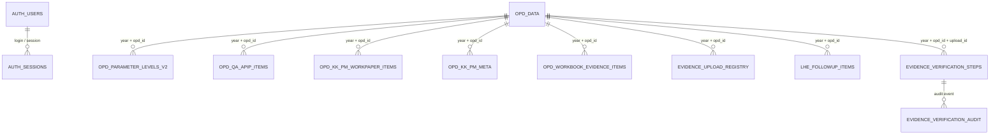

# Blueprint Multi-Tenant Kawal SPIP — Mahakam Ulu

Dokumen ini menjelaskan model akun, isolasi tenant per OPD, struktur data, aliran data, kebutuhan Cloudflare, dan pengujian penerimaan. Blueprint ini diselaraskan dengan kode sumber yang dilampirkan dan daftar OPD di permintaan.

## 1. Rekonsiliasi jumlah OPD

Daftar bernomor dari pemohon berisi **27 OPD**. Master bawaan aplikasi `MAHULU_DEFAULT_OPDS` berisi 28 OPD dan tambahan itu adalah **Badan Pengelola Keuangan dan Aset Daerah (BPKAD)**. Agar akun yang sudah dipetakan ke master aplikasi tidak hilang, berkas akun yang disediakan berisi **28 akun Operator OPD**, yaitu 27 nama dari daftar permintaan + BPKAD. Mohon konfirmasi secara administratif bahwa BPKAD memang perlu ada; bila tidak, nonaktifkan/hapus akun `opd_bpkad` dan keluarkan OPD tersebut dari master dengan perubahan kode terencana.

## 2. Peran dan batas akses

| Role | Akun bootstrap yang disiapkan | Cakupan / kemampuan |
|---|---|---|
| `admin` | `admin_daerah` | Super Admin daerah: semua OPD/tahun, konfigurasi aplikasi, tambah OPD, dan manajemen akun. |
| `opd` | Satu username untuk setiap OPD | Satu cakupan nama OPD. Tidak boleh memakai wildcard. Data yang dibaca API difilter berdasarkan cakupan server. |
| `auditor` | `auditor_inspektorat` | Lintas OPD untuk input/pemeriksaan sesuai daftar aksi yang diizinkan. |
| `irban` | `verifikator_irban` | Lintas OPD untuk tahap verifikasi Irban. |
| `bpkp` | `verifikator_bpkp` | Lintas OPD untuk verifikasi akhir dan fitur nilai resmi BPKP. `BPKP_ADMIN_PASSWORD` tetap diperlukan untuk tindakan nilai resmi yang meminta secret tambahan. |

Daftar bootstrap berisi 32 akun: 1 Super Admin + 28 Operator OPD + 1 Auditor + 1 Irban + 1 BPKP. Password awal dibuat unik secara acak (24 karakter) dan disertakan **hanya** di berkas JSON bootstrap terpisah dan CSV rahasia, bukan dalam kode sumber atau ZIP deployment.

## 3. Cara mengatur akun awal

1. Di Cloudflare Pages, tambahkan **Secret** `KAWAL_SPIP_USERS_JSON` di environment **Production**.
2. **Tempel JSON ringkas satu baris, bukan hasil pretty-print.** Berkas `KAWAL_SPIP_USERS_JSON.json` yang disediakan berukuran **4.261 byte** dan berada di bawah batas ukuran 5 KB per environment variable/secret Cloudflare. Batas resmi Cloudflare tercantum pada [dokumentasi Limits](https://developers.cloudflare.com/workers/platform/limits/). Agar muat, JSON bootstrap sengaja tidak memuat field opsional `enabled` (parser menganggap akun aktif jika field tidak ada) dan tidak memuat `displayName` untuk akun Operator OPD (nama tampilan menjadi username; `opdName` tetap berisi nama OPD lengkap). Jangan mengubahnya menjadi multi-baris atau menambah field sebelum dipasang.
3. Deploy kode terbaru, kemudian login sekali menggunakan `admin_daerah`. Pada permintaan login pertama, API memvalidasi JSON, membuat tabel `auth_users` bila belum ada, lalu menyimpan password sebagai hash PBKDF2-SHA-256 dengan salt per pengguna. Password mentah tidak disimpan dalam kolom D1.
4. Setelah login berhasil, buka menu **Manajemen Akun** dan pastikan terdapat 32 akun aktif serta cakupan setiap Operator OPD benar. Baru setelah itu distribusikan kredensial melalui kanal privat masing-masing.
5. Demi mengurangi masa simpan password mentah, setelah semua akun ter-bootstrap dan sudah diverifikasi di D1, secret `KAWAL_SPIP_USERS_JSON` boleh dihapus dari Production. Akun yang telah di-bootstrap tetap bekerja dari hash D1; akun baru berikutnya dibuat dari menu Manajemen Akun. Jangan hapus secret sebelum login bootstrap berhasil.

`KAWAL_SPIP_USERS_JSON` merupakan sumber *bootstrap satu kali*, bukan sinkronisasi dua arah. Setelah `auth_user_seed_state` ditandai, perubahan isi secret tidak menimpa password/role akun yang sudah terdaftar. Perubahan selanjutnya dilakukan melalui menu Manajemen Akun atau lewat prosedur administrasi D1 yang diaudit.

## 4. Menambah OPD dan akun manual

1. Login sebagai `admin_daerah`.
2. Pilih tahun yang akan digunakan.
3. Klik **Tambah OPD**, masukkan nama resmi OPD secara lengkap, lalu simpan.
4. Klik **Manajemen Akun** → isi username unik (huruf/angka/titik/garis bawah/tanda hubung), nama tampilan, role `Operator OPD`, pilih satu OPD, dan password unik minimal 16 karakter.
5. Setelah akun dibuat, pastikan nama cakupan tampil benar, logout, lalu login dengan akun baru. Coba buka OPD lain melalui UI/API; permintaan harus ditolak.
6. OPD manual hanya dibuat pada **tahun yang sedang dipilih**. Untuk dashboard lintas tahun, tambahkan OPD yang sama di setiap tahun yang relevan dengan nama kanonis sama, atau lakukan migrasi lintas tahun yang diuji terlebih dahulu.
7. Jika perlu mengganti password, gunakan **Reset sandi**. Untuk menonaktifkan/mengaktifkan akun gunakan tombol status; sesi aktif pengguna yang dinonaktifkan dicabut. Akun Admin aktif terakhir tidak dapat dinonaktifkan.

## 5. Model relasi data

### Tabel utama

| Tabel / binding | Fungsi dan kunci hubungan |
|---|---|
| `opd_data` | Rekaman tenant/tahun utama. `id` adalah ID OPD pada tahun tersebut; pasangan `id + year` digunakan oleh API. Berisi nilai ringkasan dan data workbook JSON yang kompatibel dengan UI. |
| `auth_users` | Akun terkelola. `username_key` adalah primary key lowercase; menyimpan `role`, cakupan `opd_names_json`/`opd_ids_json`, hash dan salt password, enabled, timestamps. Tidak menyimpan password mentah. |
| `auth_sessions` | Sesi server. `token_hash` adalah primary key; cookie browser berisi token acak, sedangkan token yang disimpan di D1 berupa SHA-256. Sesi berakhir setelah 12 jam atau dapat dicabut ketika akun dinonaktifkan/reset password. |
| `auth_user_seed_state` | Penanda agar JSON bootstrap tidak menimpa akun yang telah dikelola. |
| `opd_parameter_levels_v2` | Level parameter terstruktur dengan kunci `(year, opd_id, subunsur, param_id)`; `opd_data.subunsurs` masih dipakai untuk kompatibilitas. Nilai JSON yang ada diutamakan dan tabel v2 menjadi fallback untuk nilai level yang tidak ada. |
| `opd_qa_apip_items` | Jawaban QA APIP berbasis item workbook; kunci `(year, opd_id, subunsur, param_id, grade, item_no)`. Ringkasan dashboard menghitung checked, passed, partial, failed, pending. |
| `opd_kk_pm_workpaper_items` / `opd_kk_pm_meta` | Rincian kertas kerja KK PM SPIP per tahun, OPD, target T1–T4, sub-unsur, dan parameter; meta menyimpan PIC/penelaah/persetujuan per target. |
| `opd_workbook_evidence_items` | Bukti dukung per parameter/target/grade, metadata file, status sinkronisasi Drive, dan status verifikasi. |
| `evidence_upload_registry` / `evidence_uploads` | Registry ID upload, pasangan year+opd, R2 key, Google Drive ID, status sinkronisasi. Registry digunakan untuk memeriksa pemilikan file. |
| `lhe_followup_items` | Rencana tindak lanjut rekomendasi LHE per OPD/tahun, sumber tahun, rekomendasi, rencana, indikator, `evidence_required`, PIC, tenggat, realisasi aktual, status pelaksanaan, bukti JSON, serta status verifikasi. |
| `evidence_verification_steps` / `evidence_verification_audit` | Status workflow per upload dan audit riwayat keputusan Auditor/Irban/BPKP. |
| `bpkp_official_scores` / `bpkp_official_score_audit` | Nilai resmi per tahun (agregat, bukan tabel per OPD) dan riwayat perubahan/finalisasi. Aksesnya tetap role-gated dan memakai secret BPKP untuk operasi tertentu. |
| `DB` (D1) | Database utama. Nama binding harus `DB`; diarahkan ke database `kawal-spip-db`. |
| `EVIDENCE_BUCKET` (R2) | Berkas bukti privat. File diidentifikasi oleh `uploadId` dan `r2_key`; akses harus melalui endpoint yang melakukan cek sesi/cakupan. |
| `REALTIME` (Durable Object) | Notifikasi perubahan dashboard realtime; bukan sumber data utama. |
| Google Sheets API | Sumber/target workbook eksternal sesuai spreadsheet ID yang tersimpan di data workbook OPD dan variabel `GOOGLE_SHEETS_*`; OAuth Drive dipakai untuk backup berkas. |

## 6. Tarikan dan aliran data

1. **Login** → `KAWAL_SPIP_USERS_JSON` hanya dipakai untuk bootstrap awal → password disimpan dalam hash di `auth_users` → sesi diverifikasi server untuk setiap aksi terproteksi.
2. **Muat dashboard** → API `getData` memastikan daftar master OPD pada tahun aktif lengkap → baca `opd_data` dan ringkasan tabel parameter/QA/KK/evidence → filter hasil menurut cakupan sesi → frontend hanya menampilkan tenant yang diizinkan.
3. **Input parameter** → API menulis perubahan kecil ke D1 yang dipasangkan ke `year + opd_id`; nilai agregat dihitung dari sumber data, bukan diketik bebas bila kode menandainya sebagai turunan workbook.
4. **Workbook KK/PM/RTP** → spreadsheet ID dan snapshot workbook disimpan per rekaman OPD; Google Sheets API membaca/menulis template ketika ID dan OAuth tersedia. Baris OPD saja **tidak otomatis membuat spreadsheet Google baru** jika `workbookSpreadsheetId` masih kosong. Buat/tautkan workbook melalui alur di aplikasi dan uji ID sheet per OPD.
5. **Upload evidence** → berkas ke R2 privat, metadata dan `uploadId` ke D1, lalu backup Drive bila integrasi tersedia. Kegagalan Drive harus tampak sebagai `retrying/pending`, bukan dianggap tersinkron.
6. **Verifikasi** → Auditor mengirim → Irban menerima/mengembalikan → BPKP final setelah Irban menerima. Perubahan evidence mengharuskan verifikasi ulang.
7. **Rekap Super Admin** → agregat didasarkan pada seluruh row OPD di tahun terpilih. Rekap antar tahun tidak boleh menjumlahkan ID yang sama tanpa memasukkan `year`.

### Hal yang harus diverifikasi secara live

Kode dapat memvalidasi nama tabel, route, scope, dan mapping statis, tetapi dari lingkungan pengembangan ini tidak dapat membaca database D1 produksi, status bucket R2, permission Google Workspace, atau ID semua workbook. Setelah deploy, buat checklist yang menunjukkan untuk setiap OPD: `opd_data` ada per tahun, workbook spreadsheet ID terisi jika fitur tersebut dipakai, dapat dibaca melalui OAuth, upload ke R2 berhasil, dan backup Drive berstatus `done`. Jangan menyebut semua tarikan live telah berhasil hanya karena login atau tabel tersedia.

## 7. Secrets dan bindings Cloudflare

### Secret / variable

- `KAWAL_SPIP_USERS_JSON` — secret bootstrap akun; setelah bootstrap diverifikasi bisa dihapus.
- `BPKP_ADMIN_PASSWORD` — secret tambahan untuk operasi nilai resmi BPKP.
- `DELETE_PASSWORD` — secret untuk alur konfirmasi hapus yang masih memakainya.
- `ACCESS_PASSWORD` — kompatibilitas login lama; tidak digunakan jika daftar akun terkelola telah ada.
- `GOOGLE_DRIVE_CLIENT_ID`, `GOOGLE_DRIVE_CLIENT_SECRET`, `GOOGLE_DRIVE_REFRESH_TOKEN`, `GOOGLE_DRIVE_FOLDER_ID` — OAuth/backup Google Drive, sesuai kebutuhan fitur.
- `GOOGLE_SHEETS_PM_TEMPLATE_ID`, `GOOGLE_SHEETS_RTP_TEMPLATE_ID`, dan variabel master/template PK — ID spreadsheet, pastikan nama lengkapnya sesuai kode.
- `KK_MASTER_SYNC_SECRET` — secret sinkronisasi master, minimal 32 karakter jika endpoint manual dipakai.

### Bindings yang bukan Environment Variable

- `DB`: D1 `kawal-spip-db`.
- `EVIDENCE_BUCKET`: R2 `kawal-spip-files`.
- `REALTIME`: Durable Object `RealtimeHub` dari Worker `kawal-spip-realtime`.

Jangan masukkan token, password, atau JSON akun ke kode sumber. Source ZIP hanya menyertakan contoh JSON dengan placeholder; JSON rahasia dan CSV kredensial diserahkan terpisah.

SQL diagnostik read-only untuk D1 disediakan di `database/diagnostic_queries.sql`. Jalankan query satu per satu setelah deployment untuk memeriksa hitungan akun, tenant per tahun, spreadsheet ID tersimpan, sinkronisasi evidence, item KK PM, LHE, dan jejak verifikasi. Query diagnostik tidak membuktikan hak akses runtime; tetap lakukan percobaan login dan tes akses lintas OPD.

## 8. Validasi yang dilakukan dan yang belum

**Lulus dalam pemeriksaan statis paket:** 28 nama OPD pada konfigurasi akun cocok dengan master bawaan; 28 username Operator OPD berbeda; 32 username total unik; seluruh password bootstrap unik dengan panjang 24 karakter; role sesuai daftar aplikasi; JavaScript handler dan frontend lolos `node --check`; file JSON dapat diparse. Seed OPD diubah agar menambahkan master yang hilang walau tabel sudah berisi sebagian data. Menu manajemen akun menambah akun baru ke D1, melakukan reset password, dan mencabut sesi ketika akun dinonaktifkan. Role Auditor juga memakai allowlist eksplisit agar aksi API yang tidak disetujui tidak otomatis terbuka.

**Belum dibuktikan tanpa deployment:** keberhasilan login aktual, performa PBKDF2 di runtime Cloudflare, akses antar-OPD lewat API pada D1 produksi, izin R2/Google Drive, keberhasilan pembacaan dan penulisan seluruh spreadsheet, dan status live semua 28 workbook. Lakukan tes penerimaan di bawah ini setelah deploy.

## 9. Checklist penerimaan wajib

- [ ] Bootstrap D1 menampilkan 32 akun aktif (1 admin, 28 OPD, 1 auditor, 1 Irban, 1 BPKP).
- [ ] Setiap 28 akun Operator OPD hanya melihat satu OPD sesuai nama; uji ID OPD lain via API juga tertolak.
- [ ] Memiliki satu baris master untuk setiap OPD di tahun yang aktif; jalankan ulang `getData`, pastikan tidak menambah duplikat.
- [ ] Akun baru yang dibuat melalui UI dapat login, dan terikat ke OPD yang dipilih.
- [ ] Reset password mencabut sesi sebelumnya; nonaktifkan akun mencabut sesi dan login berikutnya ditolak.
- [ ] Super Admin dapat melihat rekap lintas OPD, akun OPD tidak.
- [ ] Untuk tiap OPD, periksa workbook ID, access Google Sheets, formula/kolom KK3.1–KK3.4, dan sumber KK PM/RTP yang terkait.
- [ ] Upload/unduh bukti memakai URL privat dan menolak sesi tanpa hak; setelah tes berhasil, nonaktifkan public development URL R2 bila sempat digunakan.
- [ ] Verifikasi bertahap Auditor → Irban → BPKP berfungsi; keputusan BPKP sebelum penerimaan Irban ditolak.
- [ ] Dashboard jumlah dokumen/kegiatan dihitung dari data yang benar-benar ada, bukan angka statis atau jumlah nama template.
